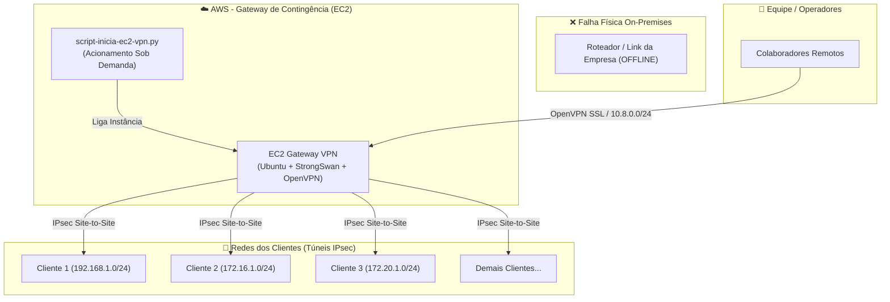

# 🛡️ AWS VPN Failover & Disaster Recovery Gateway

Solução de **Contingência e Disaster Recovery (DR)** para continuidade de negócios. Em caso de queda do roteador físico, falha de link ou indisponibilidade na infraestrutura on-premises da empresa, uma instância **AWS EC2** é ativada sob demanda para assumir a ponte dos túneis **IPsec (StrongSwan)** diretamente com os clientes/parceiros e fornecer acesso à equipe via **OpenVPN**, contornando 100% da falha física local com custo de computação quase zero em repouso.

---

## 🎯 O Problema e a Solução Proposta

### ❌ O Cenário de Falha (Disaster Recovery)
Quando a sede da empresa sofre uma queda física (pane elétrica, queima de hardware do roteador de borda ou interrupção de link de internet), a comunicação direta via túneis IPsec entre a empresa e seus múltiplos clientes é interrompida, paralisando serviços críticos.

### ✅ A Solução Implementada
1. **EC2 Standby (Custo Quase Zero):** Uma instância EC2 na AWS é pré-configurada e mantida **desligada**, gerando custo apenas de armazenamento do disco EBS.
2. **Ativação Imediata via Script Local (`script-inicia-ec2-vpn.py`):** Ao detectar a queda on-premises, o operador executa o script no computador local (notebook/contingência com 4G/rede externa). O script comunica-se via AWS CLI, liga a EC2 em segundos, captura o IP público alocado e já abre o túnel administrativo SSH.
3. **Ponte Direta com Clientes (StrongSwan IPsec):** A EC2 assume a terminação dos túneis IPsec com seu IP público e reestabelece as conexões criptografadas com cada um dos clientes/parceiros sem depender de nenhum equipamento físico da empresa.
4. **Acesso dos Operadores (OpenVPN):** A equipe remota conecta-se à EC2 via OpenVPN (SSL) e passa a alcançar os ambientes dos clientes normalmente.

---

## 🌐 Arquitetura do Failover



---

## 🛠️ Tecnologias e Protocolos

- **Cloud Provider:** Amazon Web Services (AWS EC2 - Ubuntu 20.04/22.04+)
- **Túneis com Clientes (Site-to-Site):** StrongSwan (IPsec IKEv1/IKEv2, ESP, AES-128/SHA256, PSK)
- **Acesso da Equipe (Point-to-Site):** OpenVPN Server (SSL/TLS PKI, AES-256)
- **Automação de Acionamento:** Python 3 (AWS CLI / Subprocess)
- **Automação do Gateway:** Shell Script (Bash + iptables NAT/Forwarding)

---

## 📂 Estrutura do Repositório

```text
aws-vpn-gateway-automation/
├── script-inicia-ec2-vpn.py       # Script local que liga a EC2 via AWS CLI e conecta via SSH
├── vpn-strongswan-aws-generic.sh  # Provisionamento e configuração dos túneis IPsec e OpenVPN na EC2
├── .gitignore                    # Proteção contra commit de chaves .pem, .secrets e .ovpn
└── README.md                     # Documentação de arquitetura e contingência
```

---

## ⚙️ Procedimento Operacional de Contingência (Passo a Passo)

### 🚨 1. Acionamento em Caso de Falha
Caso o roteador da empresa caia, qualquer operador autorizado executa o script no terminal local:

```bash
python script-inicia-ec2-vpn.py
```

**O que acontece:**
1. A AWS CLI envia o comando `ec2 start-instances` para a VM de contingência.
2. O script aguarda a inicialização e obtém o IP público da instância.
3. Uma sessão SSH interativa é estabelecida imediatamente no terminal.

---

### 🚀 2. Instalação e Preparação da VM (Setup Inicial)

Caso esteja configurando uma nova instância de contingência na AWS:

```bash
# 1. Conecte-se na EC2 e baixe o script de provisionamento
wget https://raw.githubusercontent.com/igorpaiva26/aws-vpn-gateway-automation/main/vpn-strongswan-aws-generic.sh
chmod +x vpn-strongswan-aws-generic.sh

# 2. Execute a instalação como root
sudo ./vpn-strongswan-aws-generic.sh
```

O script realiza:
- Instalação e configuração do StrongSwan e OpenVPN.
- Ativação do roteamento de pacotes no Kernel (`net.ipv4.ip_forward=1`).
- Configuração das regras de firewall iptables (MASQUERADE entre as subnets dos clientes e a VPN).
- Criação da PKI e perfis de clientes OpenVPN em `/root/client-configs/`.

---

### 🔧 3. Ajuste dos Clientes e Chaves Secretas

No arquivo `/etc/ipsec.conf` e `/etc/ipsec.secrets`:
- **Chaves PSK:** Configure a chave pré-compartilhada combinada com cada cliente em `/etc/ipsec.secrets`.
- **IPs e Subnets dos Clientes:** Atualize os endereços dos roteadores remotos de cada cliente (`right=IP_DO_CLIENTE`) e as subnets correspondentes (`rightsubnet=REDE_DO_CLIENTE/24`).

Reinicie o serviço para subir os túneis:
```bash
sudo systemctl restart strongswan-starter
```

---

## 📋 Pré-requisitos de Infraestrutura na AWS

1. **Security Group da EC2:**
   - `UDP 500` (IKE IPsec)
   - `UDP 4500` (IPsec NAT-Traversal)
   - `UDP 1194` (OpenVPN)
   - `TCP 22` (SSH administrativo)
2. **Source/Destination Check:** Deve ser **desabilitado** na interface de rede da EC2 para permitir tráfego de roteador/gateway.

---

## 🔍 Comandos de Validação e Status

Com a EC2 ativa durante o failover, utilize os comandos abaixo para validar a saúde dos túneis:

```bash
# Checar status e conexões ativas do IPsec com os clientes
sudo ipsec status
sudo ipsec statusall

# Checar status dos serviços
sudo systemctl status strongswan-starter
sudo systemctl status openvpn-server@server

# Acompanhar logs de negociação do túnel IPsec
sudo journalctl -u strongswan-starter -f
```

---

## 👤 Autor

Desenvolvido por **[Igor Paiva](https://github.com/igorpaiva26)**.  
*Arquitetura de resiliência e continuidade de negócios focada em contingência de conectividade corporativa.*
